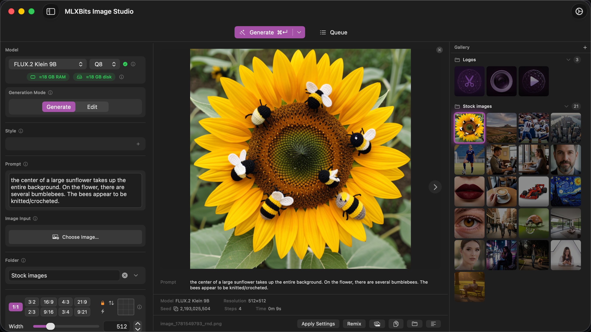
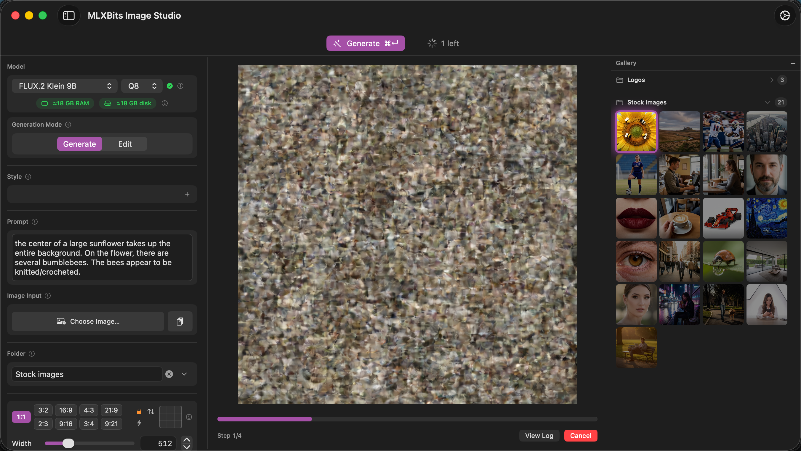
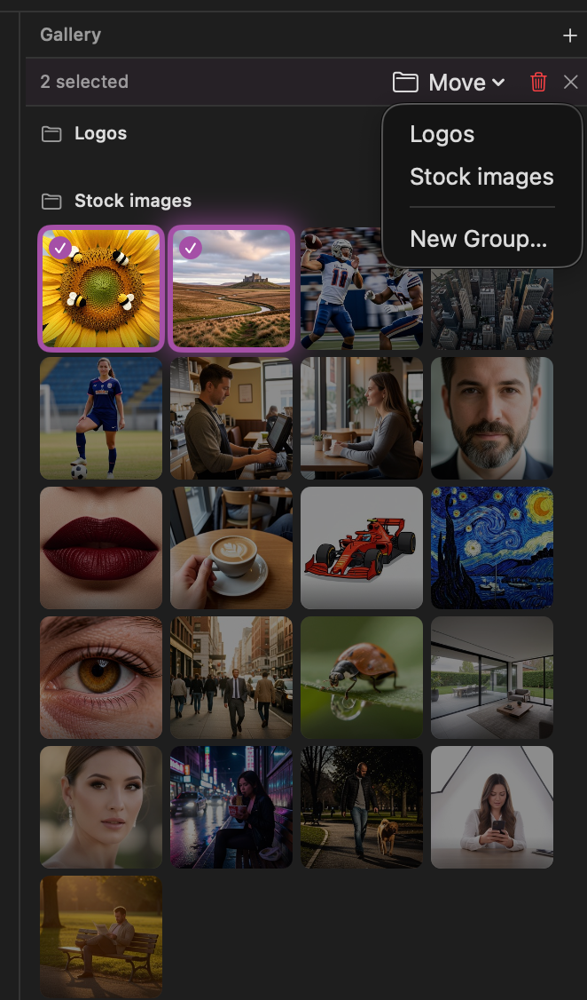
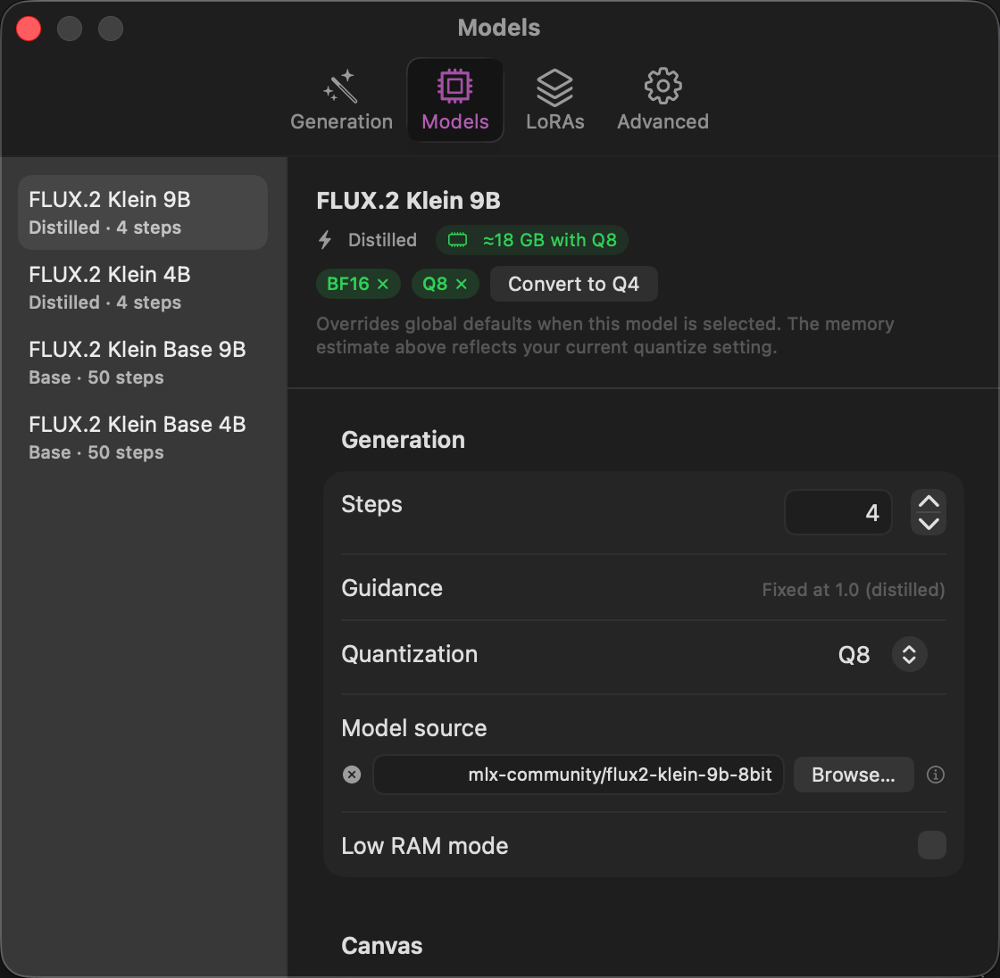

# MLXBits Image Studio

A native macOS Swift app for **FLUX, Krea 2, Z-Image, and Ideogram 4 image generation** powered by [mflux](https://github.com/filipstrand/mflux) and Apple MLX. Queue jobs, watch generations unfold step-by-step, cull and compare results in a Lightroom-style gallery, and even write prompts with a local LLM — all without a CLI, and NOT yet another Electron container "app".

> **Requires macOS Tahoe 26.0+** and Apple Silicon M-series. [mflux](https://github.com/filipstrand/mflux) ships inside the app; nothing is installed on first launch.

---

## Screenshots

| Main window                                      | Live preview                                      |
| ------------------------------------------------ | ------------------------------------------------- |
|  |  |

| Gallery                                  | Settings                                   |
| ---------------------------------------- | ------------------------------------------ |
|  |  |

---

## Features

- **Text-to-image and image-to-image** generation via FLUX.2 Klein, Krea 2 Turbo, and Z-Image models
- **FLUX.3 Klein** — text-to-image and multi-reference editing, in distilled and base variants
- **Krea 2 Turbo** — fast photographic model family, with img2img support
- **Z-Image & Z-Image Turbo** — Tongyi's 6B single-stream model; the distilled Turbo (9-step, guidance-free) and the base variant (classifier-free guidance + negative prompt), both with img2img and LoRA
- **Ideogram 4** — structured-caption generation with a regional bounding-box layout editor and Gemma-assisted caption authoring
- **SeedVR2 upscaling** — diffusion super-resolution at 2×, 3× or 4× from an **Upscale…** action on any image
- **Warm-model engine** — keeps the model loaded between generations, eliminating reload time on consecutive runs
- **Scenario generator** — turn a rough outline into finished prompts with a local LLM (no API key, no network round-trip)
- **Step-by-step live preview** — watch the image denoise in real time
- **Persistent job queue** — queue multiple jobs (processed FIFO), they survive app restarts
- **Lightroom-style gallery** — cull with pick/reject flags, filter by metadata or model family, and compare results side-by-side; thumbnail cache and metadata sidecars keep scans fast
- **Prompt history & notepad** — searchable, pinnable prompt history plus a markdown notepad for reusable notes
- **Wildcards & batches** — independent wildcard sampling, spread-across-batch seeds, and img2img prompt adoption
- **LoRA support** — add any number of LoRA adapters with per-adapter strength sliders and reordering (not available for FLUX.3)
- **Batch generation** — run 1, 3, 5 or a custom count with auto-incrementing seeds, plus a learned generation-time estimate
- **Shortcut keys** — `Command + Enter` for one-shot generation, `Option + Command + Enter` for batch generation
- **Model defaults** — save per-model presets (steps, guidance, LoRAs, dimensions)
- **Prompt templates** — save and reuse favorite prompt fragments like lighting, camera style
- **Metadata tools** — token counter with a 512 soft-cap for FLUX.2, and one-click stripping of embedded metadata from exported images
- **Low-RAM mode** — streams transformer blocks to cut peak Metal memory ~75%
- **HuggingFace integration** — enter your HF token once (stored in Keychain); gated models download automatically

## Supported models

| Variant                     | Steps | Notes                                                                   |
| --------------------------- | ----- | ----------------------------------------------------------------------- |
| FLUX.3 Klein (distilled)    | 16    | Text-to-image and multi-reference editing                               |
| FLUX.3 Klein (base)         | ~50   | Full diffusion with guidance; text-to-image and multi-reference editing |
| FLUX.2 Klein 4B (distilled) | 4     | Fastest                                                                 |
| FLUX.2 Klein 9B (distilled) | 4     | Best quality/speed trade-off                                            |
| FLUX.2 Klein 4B (base)      | ~50   | Full diffusion                                                          |
| FLUX.2 Klein 9B (base)      | ~50   | Full diffusion                                                          |
| Krea 2 Turbo                | 8     | Fast photographic model; text-to-image and img2img                      |
| Z-Image Turbo               | 9     | Tongyi's distilled 6B single-stream model; guidance-free, text-to-image and img2img; BF16/Q8/Q4 (Q4 loads a pre-quantized MLX repo) |
| Z-Image (base)              | ~50   | Base Z-Image with classifier-free guidance and a negative prompt        |
| [Ideogram 4](docs/models/ideogram4.md) | preset | Structured-caption model; FP8/Q8/Q4 precision selector (gated repo — accept terms on HuggingFace) |
| Custom                      | any   | Any HuggingFace repo ID or local path, loaded as any model above — pick the architecture it matches under "Loads as" |

---

## Requirements

| Requirement   | Version     |
| ------------- | ----------- |
| macOS         | Tahoe 26.0+ |
| Apple Silicon | M1 or later |

Everything the app runs (Python, mflux, and the local Gemma tools) ships inside the app (about 1.6 GB installed), so there is nothing to install on first launch and nothing is downloaded except model weights.

**Upgrading from 0.15 or earlier:** the app no longer uses the mflux that earlier versions installed with uv. To reclaim its space, run `uv tool uninstall mflux`. If you pointed the app at your own mflux checkout, 0.16.0 keeps using it as **Settings → Advanced → Python → Custom Python**.

---

## Installation

### Mac App Store

The App Store version runs sandboxed. On first launch it asks for a library folder and a models folder.

### DMG

Download the latest `MLXBits_Image_Studio_<version>.dmg` from [Releases](../../releases/latest), open it, and drag **MLXBits Image Studio** to `/Applications`.

The app is signed and notarized by Apple, so it should launch without any Gatekeeper prompt. The DMG version is unsandboxed and can also run mflux from your own Python install.

Image Studio is free either way, and it collects no data: see the [privacy policy](PRIVACY.md).

Like the app? Support me by [buying me a coffee](https://ko-fi.com/mlxbits). :) Your support helps keep my apps and other content free.

---

To build from source or contribute, see [DEVELOPMENT.md](DEVELOPMENT.md).

## License

MIT — see [LICENSE](LICENSE). mflux, MLX and the models the app downloads
carry their own licenses.
